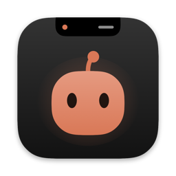

# NotchKeeper

A small island in your MacBook's notch that shows your **Claude Code** sessions live
and lets you approve permissions with one click — without switching to the terminal.

**English** · [Polski](README.pl.md)



<!-- Demo GIF: docs/demo.gif (right-click the notch → Tryb demo) -->

- **Live sessions** — status (working / waiting for you / done / error), current tool and file, duration; several sessions at once.
- **Permissions from the island** — a card with the full command or file and *Allow / Deny / Always* buttons.
  No click = Claude asks in the terminal as usual.
- **Mascot** — changes its face and colour with the session state, follows your cursor.
- **Battery friendly** — fully event-driven; the hidden island uses ≈ 0% CPU.
- **Full screen aware** — hides over full-screen apps; a waiting permission still shows up.
- **Liquid Glass** on macOS 26 (material fallback on macOS 15), adjustable transparency.
- ⌥⌘N shortcut, optional sounds, launch at login; a screen without a notch gets a “pill” at the top.

Requires macOS 15 or newer. No telemetry, no network connections.

> The interface is currently in Polish only. Menu names below are given in Polish with an English translation.

## Install

1. Download `NotchKeeper-<version>.dmg` (or `.zip`) from [Releases](../../releases) and drag **NotchKeeper.app** to **Applications**.
2. First launch: the app is not notarized by Apple, so macOS will block it.
   **Right-click NotchKeeper.app → Open → Open.**
   If there is no such button (newer macOS): *System Settings → Privacy & Security → “NotchKeeper” was blocked → Open Anyway*.
   Or from the terminal:
   ```bash
   xattr -dr com.apple.quarantine /Applications/NotchKeeper.app
   ```
3. **Right-click the notch** → **Hooki Claude Code…** (Claude Code hooks) → review the changes → **Zainstaluj** (Install).
4. Start a new `claude` session — the island comes alive.

### What installing the hooks does

- Copies a small helper, `notchkeeper-hook`, to `~/Library/Application Support/NotchKeeper/bin/`.
- Adds entries to `~/.claude/settings.json` (SessionStart, UserPromptSubmit, PreToolUse, PostToolUse,
  Notification, Stop, SessionEnd, PermissionRequest). Before saving it shows a diff and makes a dated backup.
- Leaves other hooks untouched. **Odinstaluj** (Uninstall) in the same window removes only NotchKeeper entries.

The hook never blocks Claude Code: if the app isn't running, it exits immediately.
Communication goes only through a local Unix socket (`~/Library/Application Support/NotchKeeper/notch.sock`, mode 0600).

## Usage

| Action | How |
|---|---|
| Open / close the island | hover the notch, click, or ⌥⌘N |
| Collapse | Esc or click outside |
| Answer a permission | *Pozwól* (Allow once), *Zawsze* (Always — remember the rule), *Odrzuć* (Deny), *W terminalu* (answer in the terminal) |
| Menu (Ustawienia / Settings, Hooks, Tryb demo / Demo mode, Quit) | **right-click the notch** |

## Uninstall

1. Right-click the notch → **Hooki Claude Code…** → **Odinstaluj**.
2. Quit the app and delete `NotchKeeper.app` and `~/Library/Application Support/NotchKeeper/`.

## Build from source

Requires Xcode 26+ and [XcodeGen](https://github.com/yonaskolb/XcodeGen).

```bash
xcodegen && xcodebuild -scheme NotchKeeper -configuration Debug -derivedDataPath build build
```

```bash
./scripts/release.sh
```

`release.sh` builds Release and creates `dist/NotchKeeper-<version>.zip` and `.dmg` (ad-hoc signed).
The icon is generated with `swift scripts/make-icon.swift`.

Without an Apple Developer account the app is ad-hoc signed, hence the “right-click → Open” step.
With a Developer ID it can be signed and notarized so it opens normally.

## Acknowledgements

Inspired by [Coucou](https://github.com/Louis-CFM/coucou) by Louis-CFM (MIT) — thank you!
NotchKeeper's code, mascot and artwork are its own.

## License

[MIT](LICENSE) © 2026 PanBismarck
